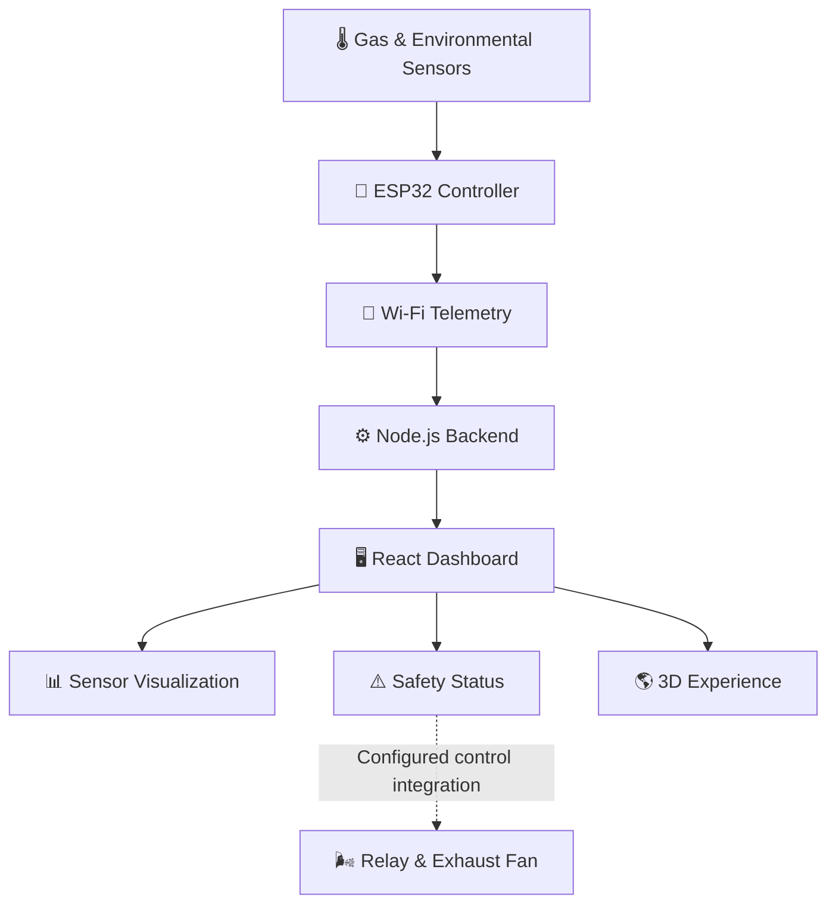

# 🌐 SafeSewer+ | Intelligent Underground Safety Monitoring

<p align="center">
  
  
  
</p>

<p align="center">
  <strong>Safety Begins Below.</strong>
  <br />
  An intelligent IoT platform for underground environmental monitoring, hazardous gas detection, and connected safety visualization.
</p>

<p align="center">
  <a href="#-overview">Overview</a> •
  <a href="#-features">Features</a> •
  <a href="#-technology-stack">Tech Stack</a> •
  <a href="#-architecture">Architecture</a> •
  <a href="#-getting-started">Get Started</a>
</p>

---

## 🚀 Overview

**SafeSewer+** is an IoT-based underground safety monitoring platform designed to improve awareness of potentially hazardous conditions in sewer and manhole environments.

Powered by an **ESP32 microcontroller**, gas sensors, environmental sensors, and a Node.js backend, the system collects sensor readings and connects them to an interactive web dashboard.

The website transforms this technical system into a cinematic digital experience, combining immersive 3D environments, scroll-driven storytelling, real-time telemetry visualization, and an interactive safety command center.

> 💡 **Our vision:** Connect underground sensing technology with modern web experiences to make environmental monitoring more accessible, informative, and actionable.

## ✨ Key Features

<table>
  <tr>
    <td width="50%">
      <h3>📡 IoT Connectivity</h3>
      Collects sensor readings using ESP32 and transmits telemetry over Wi-Fi.
    </td>
    <td width="50%">
      <h3>📊 Live Dashboard</h3>
      Visualizes sensor readings, environmental conditions, and system status.
    </td>
  </tr>
  <tr>
    <td width="50%">
      <h3>⚠️ Hazard Monitoring</h3>
      Evaluates configured thresholds and displays SAFE, WARNING, or DANGER states.
    </td>
    <td width="50%">
      <h3>🌬️ Ventilation Integration</h3>
      Supports relay-based exhaust fan integration through the configured control logic.
    </td>
  </tr>
  <tr>
    <td width="50%">
      <h3>🌎 Immersive 3D Experience</h3>
      Explores the underground environment through interactive 3D scenes.
    </td>
    <td width="50%">
      <h3>🎬 Scroll-Driven Storytelling</h3>
      Combines motion, depth, and transitions to explain the monitoring workflow.
    </td>
  </tr>
</table>

## 🧠 How It Works



### 🔄 Monitoring Workflow

1. **Sense** — Sensors collect gas-related and environmental readings.
2. **Transmit** — The ESP32 sends telemetry over Wi-Fi.
3. **Process** — The backend receives and exposes the incoming data.
4. **Evaluate** — Configured software thresholds determine the displayed safety state.
5. **Visualize** — The dashboard presents readings and status information.
6. **Respond** — Ventilation hardware can be integrated with validated control logic.

## 🛠️ Hardware Components

| Component | Function | GPIO |
|---|---|---|
| 🔌 ESP32 development board | Microcontroller and Wi-Fi connectivity | — |
| 🔥 MQ-4 | Methane-related gas sensing | GPIO 34 |
| ☁️ MQ-7 | Carbon monoxide-related gas sensing | GPIO 35 |
| 🌫️ MQ-135 | General air-quality / gas-response sensing | GPIO 32 |
| 🌡️ DHT11 | Temperature and humidity monitoring | GPIO 23 |
| ⚡ Relay module | Ventilation switching interface | GPIO 22 |
| 🌬️ Exhaust fan | Ventilation component | Through relay |

> ⚠️ **Sensor accuracy:** MQ-series sensors are cross-sensitive. Raw analog readings are not certified gas concentrations in ppm. Appropriate calibration and validation are necessary for concentration measurements.

## 💻 Technology Stack

<p align="center">
  
</p>

| Category | Technologies |
|---|---|
| 🎨 Frontend | React, TypeScript, Vite, Tailwind CSS |
| 🌎 3D Graphics | Three.js, React Three Fiber, React Three Drei |
| 🎞️ Animation | GSAP, ScrollTrigger, Framer Motion, Lenis |
| 📈 Visualization | Recharts, Lucide React |
| ⚙️ Backend | Node.js, Express.js |
| 🔌 Embedded System | ESP32, Arduino-compatible development |
| 📡 Communication | Wi-Fi telemetry, REST API |

## 🏗️ Project Structure

```text
SafeSewer+/
├── 📁 server/
│   ├── server.js
│   └── package.json
├── 📁 src/
│   ├── 📁 assets/
│   ├── 📁 components/
│   │   ├── Navigation
│   │   ├── CommandCenter
│   │   ├── LoadingScreen
│   │   └── SimulationPanel
│   ├── 📁 data/
│   │   ├── hardware.ts
│   │   └── simulation.ts
│   ├── 📁 hooks/
│   ├── 📁 pages/
│   │   └── Home.tsx
│   ├── 📁 services/
│   │   └── telemetry.ts
│   ├── 📁 state/
│   │   └── TelemetryProvider.tsx
│   ├── 📁 three/
│   ├── App.tsx
│   ├── App.css
│   ├── index.css
│   └── main.tsx
├── index.html
├── package.json
├── tailwind.config.js
└── vite.config.ts
```

*This tree highlights the main application areas; individual files may vary by version.*

## ⚡ Getting Started

### 📋 Prerequisites

Ensure you have the following installed:

- [Node.js](https://nodejs.org/) — LTS recommended
- npm
- [Git](https://git-scm.com/)
- Arduino IDE or compatible ESP32 development environment for hardware testing

### 1️⃣ Clone the Repository

```bash
git clone https://github.com/sanx001/YOUR-REPOSITORY-NAME.git
cd YOUR-REPOSITORY-NAME
```

Replace `YOUR-REPOSITORY-NAME` with your actual repository name.

### 2️⃣ Install Dependencies

From the project root:

```bash
npm install
```

### 3️⃣ Configure Environment Variables

Create a `.env` file in the frontend root:

```env
VITE_API_URL=http://localhost:5000
```

The frontend uses this variable to connect to the backend. Ensure the configured address and port match your backend setup.

For ESP32 communication over a local network, use the computer's reachable LAN IP address where necessary instead of `localhost`.

🔐 **Security tip:** Never commit `.env` files containing secrets or credentials. Add them to `.gitignore`.

### 4️⃣ Start the Backend

Open a terminal:

```bash
cd server
npm install
node server.js
```

The backend should display its running status in the terminal. The current local setup uses port `5000`.

### 5️⃣ Start the Frontend

Open a second terminal at the project root:

```bash
npm run dev
```

Open the local URL displayed by Vite.

### 6️⃣ Build for Production

```bash
npm run build
```

To preview the production build:

```bash
npm run preview
```

## 📡 Telemetry API

The frontend's real telemetry service is configured to request readings from:

```http
GET /api/sensor-data
```

### Example Response

```json
{
  "methane": 1234,
  "co": 560,
  "airQuality": 700,
  "temperature": 26.5,
  "humidity": 70
}
```

| Field | Description |
|---|---|
| `methane` | Raw MQ-4 sensor reading |
| `co` | Raw MQ-7 sensor reading |
| `airQuality` | Raw MQ-135 sensor reading |
| `temperature` | Temperature in °C |
| `humidity` | Relative humidity (%) |

*The values above are illustrative examples, not live sensor measurements. The backend must return the field names and data types expected by the frontend.*

## 🚦 Safety Status

The dashboard uses configured thresholds to display three states:

| Indicator | Meaning |
|---|---|
| 🟢 **SAFE** | No configured threshold is exceeded |
| 🟡 **WARNING** | One configured threshold is exceeded |
| 🔴 **DANGER** | Two or more configured thresholds are exceeded |

These are software-defined demonstration states, not certified safety assessments. A dashboard status or animation does not independently verify that a physical relay or exhaust fan has activated.

## 🗺️ Roadmap

- [x] ESP32-based sensor integration
- [x] Node.js backend connectivity
- [x] Interactive monitoring interface
- [x] Cinematic 3D web experience
- [ ] Calibrated gas-concentration reporting
- [ ] Historical telemetry storage and trend analysis
- [ ] Alerts and notifications
- [ ] Sensor fault and network health monitoring
- [ ] Validated ventilation automation and fail-safe mechanisms

*Roadmap items should be updated as implementation progresses.*

## 🔒 Safety Disclaimer

SafeSewer+ is a prototype intended for educational, demonstration, and further engineering development. It must **not** be used as the sole basis for deciding whether a sewer, manhole, or other confined space is safe to enter.

- Sensor accuracy depends on calibration, placement, environmental conditions, and hardware limitations.
- Raw MQ-series readings are not certified gas concentration measurements.
- Configured thresholds are not substitutes for applicable occupational safety limits.
- Physical ventilation control requires verified firmware, appropriate electrical design, fault handling, and fail-safe testing.
- Real-world deployment requires suitable certified detection equipment, validation, and compliance with applicable confined-space safety standards.

## 👨‍💻 Author

**Sanjay B**

🎓 B.Tech — Computer Science and Engineering

- GitHub: [@sanx001](https://github.com/sanx001)

## 📄 License

No license has been specified yet. Add a `LICENSE` file to define how this project may be used, modified, and distributed.

---

<p align="center">
  <strong>🌐 SafeSewer+ — Making the Unseen Environment Easier to Monitor.</strong>
  <br />
  Built with IoT, engineering, and a vision for safer underground workspaces.
</p>
